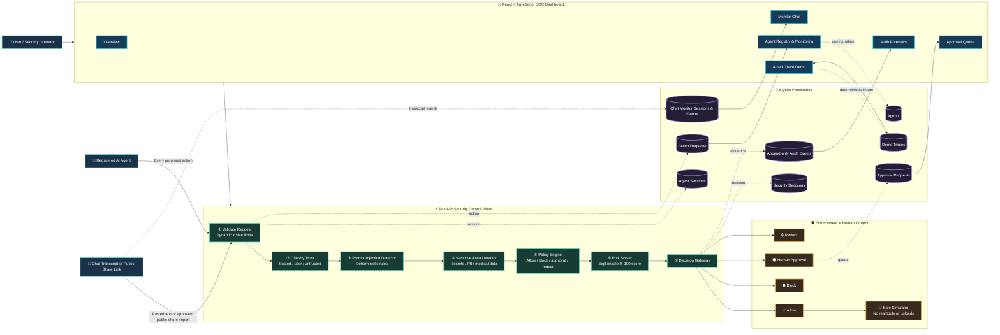

# AgentShield MVP Architecture

## Request path

1. An agent proposes an action or a user submits chat/transcript content.
2. FastAPI validates the request and applies payload limits.
3. AgentShield classifies the source as trusted, user, untrusted, or unknown.
4. Deterministic detectors inspect prompt-injection patterns and sensitive data.
5. The policy engine evaluates tools, destinations, data classification, and agent configuration.
6. The risk scorer produces a clamped, explainable score from 0 to 100.
7. The gateway returns one decision: allow, block, approval required, or redact.
8. Only allowed actions can reach the safe simulator in the MVP.
9. Decisions, approvals, detector evidence, and audit events are persisted with redaction.

## Security boundaries

- **Untrusted content boundary:** webpage and imported chat content are data, never instructions.
- **Tool boundary:** simulator tools never execute real shell commands, uploads, HTTP requests, or emails.
- **Destination boundary:** malformed, private, local, or unapproved destinations fail closed.
- **Approval boundary:** approvals are hash-bound, expiring, single-use, and audited.
- **Data boundary:** secrets and sensitive values are redacted before persistence and display.
- **Provider boundary:** the deterministic simulator works without an LLM provider.

## Technology map

| Layer | Technology | Responsibility |
|---|---|---|
| Dashboard | React, TypeScript, Vite, Tailwind CSS | SOC screens, agents, chat monitoring, approvals, demos |
| API | Python, FastAPI, Pydantic | Typed endpoints, validation, gateway orchestration |
| Detection | Deterministic Python rules | Prompt injection and sensitive-data findings |
| Decisioning | Policy engine and risk scorer | Explainable policy and risk decisions |
| Persistence | SQLAlchemy, SQLite | Sessions, actions, agents, approvals, traces, audits |
| Quality | Pytest, Vitest, React Testing Library | Unit, integration, and UI regression tests |

> AgentShield uses defense in depth. The risk score and detector results are decision aids, not proof of safety or a guarantee of perfect security.
